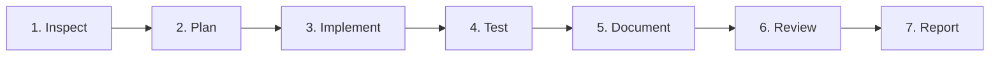

# Mandatory Repository Engineering Rules for `sfl_extension`

This document defines mandatory, non-negotiable engineering rules and operational standards for all AI coding agents working on this repository (`sfl_extension` / `sfland auto`).

---

## 1. Core Principles & Philosophy

This project is an **Autonomous Desktop RPA and Behavioral Simulation Prototype** for Sunflower Land on Windows, combining:
- OS-level Win32 hardware input emulation (`user32.dll -> SendInput` with `isTrusted: true`).
- Anti-detect browser control via GPM-Login v2 REST API & Chrome DevTools Protocol (CDP WebSocket).
- Human-Computer Interaction (HCI) stochastic modeling (Fitts' Law, Bézier curves, fatigue accumulation, circadian time-slot clustering).
- Visual perception via Claude Vision and local heuristic fallback.

Every modification must preserve behavioral realism, fault tolerance, data integrity, and strict process cleanup on Windows.

---

## 2. Mandatory Engineering Rules

### Rule A — Understand Before Editing
- **Inspect call hierarchy**: Read the affected source files and their callers before writing or modifying code.
- **Trace data & lifecycle flows**: Trace full state transitions across the session pipeline (`run.py` -> `QueueManager` -> `GpmAPI` -> `HumanMouse` -> `CropManager` -> `FarmMemory`).
- **Diagnose root cause**: Never mask bugs with try-except passes without understanding why an error occurred.
- **Minimal, focused diffs**: Avoid sweeping rewrites or unsolicited architectural overhauls. Keep edits surgical and well-reasoned.
- **Preserve user changes**: Check `git status` and `git diff` before and after edits. Never revert or overwrite unrelated user modifications.
- **Platform awareness**: This codebase runs on Windows 64-bit with Python 3.10+. Python on Windows defaults to `cp1252` encoding; all modules printing Vietnamese or Unicode characters MUST safeguard standard output using `sys.stdout.reconfigure(encoding="utf-8", errors="replace")`.

### Rule B — README Must Stay Accurate
`README.md` is the canonical, user-facing documentation of this repository.
After every implementation change, evaluate whether `README.md` is affected. Update it in the **same task** whenever changes affect:
- User-facing features, commands, or execution entry points (`run.py`, `gpm_ui.py`).
- Installation, dependency manifests (`requirements.txt`), or environment prerequisites.
- Configuration parameters (`config.json`), schema changes, or environment variables (`.env`).
- Platform requirements, browser integrations (GPM-Login), or CDP capabilities.
- Testing and diagnostic commands.
- Operational limitations, security notices, or anti-cheat research disclaimers.

*If the README is not affected, explicitly state in the final response why no update was necessary.* Never claim a feature is implemented unless substantiated by working code and tests.

### Rule C — Keep All Documentation Consistent
Maintain consistency across the canonical documentation set:
- [`README.md`](README.md): Project overview, installation, runtime usage, and architectural pillars.
- [`CHANGELOG.md`](CHANGELOG.md): Notable changes, bug fixes, breaking changes, and security updates following Keep a Changelog.
- [`docs/architecture.md`](docs/architecture.md): Subsystems, module boundaries, Win32 + CDP interaction, data flows.
- [`docs/testing.md`](docs/testing.md): Test hierarchy, mock vs. live execution, commands, regression coverage.
- [`docs/configuration.md`](docs/configuration.md): Complete schema of `config.json`, environment variables, defaults, examples.

Never commit real credentials, API tokens, passwords, personal profile data, or secret keys to any documentation or configuration file.

### Rule D — Tests Are Required for Behavioral Changes
- **Regression coverage**: Add or update automated unit/integration tests for every behavioral modification, bug fix, or new module.
- **Deterministic & Mocked**: Unit tests must run offline, deterministically, without requiring real credentials, external LLM calls, or active GPM-Login desktop sessions.
- **Boundary & failure paths**: Test valid inputs, boundary conditions (out-of-bounds screen coordinates, invalid schemas, timeouts), and failure states.
- **No test weakening**: Never comment out, delete, skip, or manipulate expected assertions merely to make a broken build pass.
- **Verified execution**: Never report tests as passing without actually executing `python -m unittest discover tests -v` and inspecting output.

### Rule E — Reliability, Concurrency & Error Handling
- **Explicit failure states**: Do not silently convert missing, null, or corrupted data into mock successes.
- **Resource cleanup (try...finally)**: Any code starting a browser profile via `GpmAPI.start_profile()` or `start_profile_by_name()` must guarantee closure via `GpmAPI.stop_profile()` in a `finally` block to prevent orphaned `chrome.exe` processes consuming system memory.
- **Atomic state persistence**: Files storing state (`personas.json`, `daily_scenarios.json`, `farm_memory.json`) must be written atomically (`write to .tmp -> os.replace` with backup `.bak`) to prevent file corruption during unexpected power-off or crashes.
- **Bounded retries & timeouts**: External HTTP requests (GPM Local API, AI Vision) must have explicit, bounded timeouts (e.g., `timeout=10`).
- **Profile Name vs. Profile ID**: The GPM UI displays human-readable profile names, but the GPM REST API requires UUIDs. Always use `find_profile_by_name()` or `start_profile_by_name()` to map names safely.

### Rule F — Security & Credential Hygiene
- **Zero committed secrets**: Never commit API keys (`sk-...`, Bearer tokens, proxy passwords) to git or `config.json`.
- **Environment variables**: Use `.env` (ignored by git) and load secrets via `os.environ.get("AI_VISION_API_KEY")` or `os.environ.get("BEEKNOEE_API_KEY")`.
- **Secret discovery**: If a real credential is found in the repository, immediately alert the user, scrub it from working files, and recommend rotation. Never print or log credentials.
- **Gitignore enforcement**: Maintain strict `.gitignore` rules for `.env`, `*.log`, `audit_trail.jsonl`, `__pycache__`, and temporary agent scratch files.

### Rule G — Dependency & Architecture Discipline
- **Explicit dependencies**: Keep all runtime requirements in [`requirements.txt`](requirements.txt) and dev requirements in [`requirements-dev.txt`](requirements-dev.txt).
- **No bloatware**: Do not introduce heavy external frameworks (Celery, Redis, Docker, Kafka, SQL engines) without explicit user authorization and clear architectural justification.
- **Modularity**: Maintain clean separation between Win32 OS interaction (`core/`), scheduler logic (`scheduler/`), task routines (`tasks/`), and user interfaces (`gpm_ui.py`, `run.py`).

### Rule H — Verification & Continuous Integration
Before completing any task:
1. Run syntax verification: `python -m compileall core scheduler tasks tests run.py gpm_ui.py`.
2. Run test suite: `python -m unittest discover tests -v`.
3. Inspect git diff: `git diff` to verify only intended changes are staged.
4. Verify documentation consistency across README, CHANGELOG, and `docs/`.
5. Report all executed commands and exact results.

---

## 3. Mandatory Workflow for Every Task

Every task assigned to an AI agent in this repository must follow this 7-step sequence:

1. **Inspect**: Read relevant code, documentation, open git changes, and check requirements.
2. **Plan**: Identify root cause, concrete file modifications, risk mitigations, and verification criteria.
3. **Implement**: Apply minimal, robust changes adhering to typing, encoding, and exception-safety standards.
4. **Test**: Run unit tests and regression checks. Verify live integrations if local services are active.
5. **Document**: Synchronize `README.md`, `CHANGELOG.md`, and relevant `docs/*.md` files.
6. **Review**: Inspect `git diff` for accidental secrets, unrelated modifications, or formatting artifacts.
7. **Report**: Produce the structured final response according to Section 4.

---

## 4. Final Response Format

Every coding task report must conclude with the following standard sections:

### Changes
- Specific files created or modified with technical rationale.
- Summary of behavior changes and architectural impacts.

### Tests and Verification
- Exact commands executed (e.g., `python -m unittest discover tests -v`).
- Test outcomes (number of passed/skipped tests, runtime).
- Any checks not executed and the technical reason.

### Documentation
- `README.md` updated: [Yes / No] (if No, state the exact reason).
- Other documentation files updated (`CHANGELOG.md`, `docs/*.md`).

### Risks and Limitations
- Known constraints, platform assumptions (Windows 64-bit, GPM port availability), or unverified edge cases.

### Git Diff
- Confirmation that unrelated user changes and working tree modifications were respected and preserved.
- Statement that code was verified locally without unauthorized commits/pushes.
