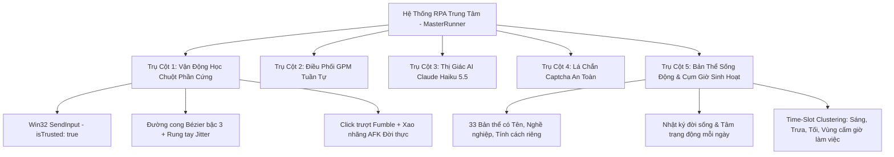

# SFL Autonomous Desktop RPA & Behavioral Simulation Prototype 🌾🤖

> **Kiến trúc Tự động hóa Desktop Nông trại Sunflower Land dựa trên Mô hình Sinh học & Thị giác Máy tính**  
> Tích hợp: **GPM-Login v2 API** | **Chuột Phần Cứng Win32 SendInput (`isTrusted: true`)** | **AI Vision Claude Haiku 5.5** | **Bản Thể Người Thật & Cụm Giờ Sinh Hoạt (Time-Slot Clustering)**

---

## 🌟 ĐẶC ĐIỂM KIẾN TRÚC: TIẾP CẬN MÔ PHỎNG THEO HỌC THUYẾT HCI

Khác với các công cụ bot hay Chrome Extension thông thường (dễ bị phát hiện do inject code JavaScript hoặc tần suất click cố định không phương sai), hệ thống này được xây dựng trên **5 Trụ cột Mô phỏng Heuristic**:



---

## 🏛️ 5 TRỤ CỘT CÔNG NGHỆ CHÍNH

### 1. Vận động học Chuột Phần cứng (`core/human_mouse.py`)
- **Sự kiện phần cứng OS-level**: Bắn trực tiếp qua Windows API `user32.dll -> SendInput` (trình duyệt nhận diện cờ `e.isTrusted: true`).
- **Quỹ đạo Cubic Bézier & Gia tốc sinh học**: Chậm ở 2 đầu (ease-in / ease-out), uốn lượn tự nhiên, có độ vọt quá đích (overshoot) rồi giật lại điều chỉnh.
- **Micro-jitter & Hold Duration**: Rung cơ tay 0.5 - 1.5 pixel, thời gian đè chuột tự nhiên 65ms – 130ms.
- **Yếu tố bất định vi mô**:
  - `HumanMouse.fumble_click()`: Mô phỏng click trượt chệch ra rìa ô đất $\rightarrow$ dừng ngỡ ngàng 300ms $\rightarrow$ click lại vào tâm.
  - `HumanMouse.simulate_distraction()`: Dừng thao tác 10 – 35 giây (như có điện thoại, shipper giao hàng, con khóc, uống nước).
  - `HumanMouse.idle_wandering()`: Rê chuột lơ đễnh ngắm cảnh xung quanh đảo.

### 2. Quản lý Độc lập Tuần tự qua GPM-Login (`core/gpm_api.py`)
- Kết nối Local REST API (`127.0.0.1:19995`).
- Vận hành **tuần tự từng Profile**: Mở 1 profile $\rightarrow$ xử lý xong $\rightarrow$ đóng an toàn $\rightarrow$ nghỉ giải lao $\rightarrow$ chuyển profile tiếp theo.
- Tiết kiệm 95% RAM/CPU so với việc mở hàng loạt trình duyệt cùng lúc.

### 3. Trí tuệ Thị giác AI Vision Claude Haiku 5.5 (`core/ai_vision.py`)
- Chụp ảnh màn hình thời gian thực qua `mss` / `PIL.ImageGrab`.
- Nhận diện tức thì:
  - Vị trí nút tắt Pop-up quảng cáo, rương sự kiện che khuất.
  - Tọa độ Nấm hoang dã (`Wild Mushrooms`) mọc ngẫu nhiên trên đảo để nhặt tự động.
  - Phát hiện dấu hiệu Captcha hoặc thông báo bất thường.

### 4. Lá chắn Captcha Khẩn cấp (`tasks/captcha_guard.py`)
- Khi phát hiện Captcha (Goblin Chest, Sunflower verification...):
  - **Phanh khẩn cấp trong 0.01s**: Dừng toàn bộ sự kiện chuột ngay lập tức, không để bot bấm bậy gây khóa tài khoản.
  - **Hú còi cảnh báo**: Phát âm thanh `winsound` báo động cho người dùng giải quyết thủ công.

### 5. Bản thể Người Thật & Phân bổ Cụm Giờ Sinh Hoạt (`scheduler/`)
- **Danh tính cố định (`scheduler/persona_manager.py`)**: Mỗi profile là một con người Việt Nam có danh xưng, độ tuổi (19–45t), nghề nghiệp (Lập trình viên, Kế toán, Sinh viên, Giáo viên, Mẹ bỉm sữa, Designer...), tính khí và thói quen thao tác riêng biệt.
- **Nhật ký Đời sống hàng ngày (`scheduler/scenario_engine.py`)**: Mỗi ngày AI viết một cuốn nhật ký đời thực (ngày tăng ca, ngày WFH trời mưa cày cuốc, ngày uể oải, ngày đi du lịch detox...).
- **Phân bổ Cụm giờ (Time-Slot Clustering)**:
  - *Sáng sớm trước khi đi làm*: 06:45 – 08:15 (1–2 phiên).
  - *Giờ nghỉ trưa công sở*: 11:45 – 13:15 (1–2 phiên).
  - *Tan tầm về nhà*: 17:30 – 18:45 (1 phiên).
  - *Buổi tối Prime Time*: 19:45 – 23:15 (2–3 phiên).
  - *Vùng cấm giờ làm việc*: Khóa hoàn toàn, không mở game bừa bãi.
  - *Ngày Marathon cày cuốc*: Mở 14 – 22 phiên rải rác cả ngày.
  - *Ngày Detox / Đi chơi*: 0 phiên hoặc 1 phiên chớp nhoáng lúc nửa đêm.
- **Chọn Hạt Giống Thích Ứng Sinh Học (`scheduler/crop_selector.py`)**:
  - Người thật luôn tính toán thời gian rảnh rỗi tiếp theo trước khi chọn hạt giống:
    + Sắp vào giờ làm việc 4 tiếng nữa mới rảnh $\rightarrow$ Gieo **Cabbage (2h) hoặc Carrot (1h)** (Tuyệt đối không gieo Sunflower 1p rồi để hoang!).
    + Sắp đi ngủ đêm 7–8 tiếng $\rightarrow$ Gieo cây qua đêm: **Parsnip (10.8h), Cauliflower (7.2h), Wheat/Radish (21.6h)**.
    + Đang trong giờ cày cuốc / Giờ trưa rảnh rỗi $\rightarrow$ Gieo cây siêu ngắn: **Sunflower (1p) hoặc Potato (5p)**.
- **Cơ chế Treo Tab Đời Thực (Tab Lingering & Life Interruption)**:
  - *Treo tab giữa phiên (`HumanMouse.tab_lingering_pause`)*: Đang chơi có hành động ngoài đời xen vào (chuông cửa, shipper gọi, pha cà phê, sếp gọi) $\rightarrow$ **Giữ nguyên tab trình duyệt mở trên màn hình từ 35s đến 120s**. Xong việc ngoài đời mới quay lại game tiếp tục gieo hạt.
  - *Nán lại sau khi hoàn thành (`HumanMouse.post_farming_linger`)*: Gieo xong hạt cuối cùng không bao giờ tắt tab ngay trong 0.1s; nán lại treo tab nhìn ruộng, rê chuột ngắm farm 8 – 25 giây rồi mới đóng an toàn!
- **Độ trễ quên tự nhiên (`scheduler/farm_memory.py`)**: Người chơi không bao giờ ngồi canh đúng từng giây để hái, luôn có độ trễ ngẫu nhiên (3 – 15 phút, đôi khi quên 1–2 tiếng).

---

## 📁 CẤU TRÚC DỰ ÁN

```
f:\sfland auto/
├── core/
│   ├── human_mouse.py        # Chuột Win32 SendInput Bézier, Jitter, Fumble & AFK
│   ├── gpm_api.py            # Kết nối GPM-Login Local API v2 (127.0.0.1:19995)
│   ├── window_helper.py      # Tìm HWND, đưa cửa sổ lên Foreground, tọa độ Client
│   └── ai_vision.py          # Thị giác Claude Haiku 5.5 chụp màn hình phân tích JSON
├── scheduler/
│   ├── persona_manager.py    # Quản lý 33 Danh tính Người thật (Tên, Tuổi, Nghề, Tính khí)
│   ├── scenario_engine.py    # Kịch bản Bối cảnh Đời sống & Cụm Giờ Sinh Hoạt (Time-Slots)
│   ├── crop_selector.py      # Bộ lựa chọn hạt giống thích ứng sinh học theo quỹ thời gian
│   ├── farm_memory.py        # Bộ nhớ chu kỳ cây, tính độ trễ quên và kiểm duyệt 3 lớp
│   └── queue_manager.py      # Lịch trình ngủ đêm sinh học, Coffee breaks & Báo cáo
├── tasks/
│   ├── captcha_guard.py      # Lá chắn Captcha phản xạ 0.01s & hú còi báo động
│   ├── crop_manager.py       # Quản lý thu hoạch & gieo hạt (Shuffle, Nhịp thở Sync, Miss-click)
│   ├── mushroom_hunter.py    # Tự động nhặt nấm hoang dã từ tọa độ AI
│   └── session_task_orchestrator.py # Điều phối đa nhiệm & Xác suất bỏ sót theo thị giác con người
├── _archive_extension/       # Lưu trữ mã nguồn Chrome Extension cũ
├── config.json               # Cấu hình hệ thống (API Key, Crop, Scheduler)
├── personas.json             # Lưu trữ ADN bản thể 33 profile
├── daily_scenarios.json      # Lưu trữ kịch bản đời sống hôm nay của các profile
├── farm_memory.json          # Lưu trữ trạng thái nông trại & chu kỳ cây trồng
├── run.py                    # BỘ ĐIỀU PHỐI TRUNG TÂM (MASTER RUNNER)
├── sfl_master_encyclopedia.md# Đại điển tri thức toàn diện game Sunflower Land
├── sfl_farm_ui_analysis.md   # Phân tích giao diện thực tế và tọa độ
├── sfl_gameplay_analysis.md  # Phân tích gameplay và bẫy Anti-Cheat
└── sfl_empirical_foundations.md # Căn cứ thực nghiệm & Phương pháp luận HCI (Fitts, MacKenzie, KLM)
```

---

## 🚀 HƯỚNG DẪN CÀI ĐẶT & VẬN HÀNH

### 1. Yêu cầu Tiên quyết
* **Hệ điều hành:** Windows 10 / 11 (64-bit).
* **Python:** Phiên bản 3.10 trở lên.
* **Phần mềm GPM-Login**: Đang cài đặt và bật API tích hợp tại cổng mặc định `127.0.0.1:19995`.

### 2. Cài đặt Thư viện Python
Mở Terminal / PowerShell tại thư mục dự án và chạy:
```powershell
pip install requests mss pillow pywin32
```
*(Nếu muốn dùng AI Vision Claude Haiku, cài thêm: `pip install openai`)*

### 3. Cấu hình (`config.json`)
Chỉnh sửa tệp [`config.json`](file:///f:/sfland%20auto/config.json) theo nhu cầu:
```json
{
  "gpm_api": {
    "base_url": "http://127.0.0.1:19995",
    "group_filter": null
  },
  "ai_vision": {
    "enabled": true,
    "api_key": "sk-bee-...",
    "base_url": "https://platform.beeknoee.com/v1",
    "model_id": "bee-tok/claude-haiku-5-5"
  },
  "farming": {
    "default_crop": "Sunflower",
    "default_grow_seconds": 60,
    "action_sync_delay_min": 0.45,
    "action_sync_delay_max": 0.85
  },
  "scheduler": {
    "sleep_start_hour": 0.5,
    "sleep_end_hour": 6.5,
    "coffee_break_every_n_profiles": 5
  }
}
```

### 4. Khởi chạy Bot
1. Mở ứng dụng **GPM-Login** trên máy tính.
2. Khởi chạy Bot:
```powershell
python run.py
```
3. Xem bảng điều khiển thời gian thực hiển thị danh tính sống động, câu chuyện đời thực và nhịp sinh học của các profile!

---

## 🛡️ AN TOÀN, BẢO MẬT & GIỚI HẠN THỰC NGHIỆM

> [!IMPORTANT]
> **KẾT LUẬN CHÍNH THỨC VỀ BẢN CHẤT DỰ ÁN:**  
> *"Đây là bộ sinh hành vi ngẫu nhiên để thử nghiệm trên giao diện giả lập. Chúng tôi chưa chứng minh nó đại diện cho người thật, chưa đánh giá độ chính xác phân loại và không tuyên bố vượt qua hệ thống kiểm tra của nền tảng."*

Xem tài liệu kiểm định chi tiết tại: [sfl_limitations_and_disclaimer.md](file:///f:/sfland%20auto/sfl_limitations_and_disclaimer.md)

### Tóm tắt 5 câu hỏi khó & câu trả lời trung thực:
1. **Cơ sở đại diện người dùng thật:** Dự án là prototype mô phỏng theo heuristic dựa trên tài liệu lý thuyết HCI (Fitts 1954, MacKenzie 1992, Flash & Hogan 1985), không thu thập dữ liệu người dùng thật (Zero Telemetry).
2. **Thực thi tác vụ trong game:** `run.py` hiện đã tích hợp trực tiếp chu trình thu hoạch (`harvest_plots`) và gieo hạt (`plant_plots`) thực tế trên tọa độ cửa sổ game đồng bộ với bộ nhớ JSON.
3. **Độ bền khi chạy lâu:** Bọc `try...finally` đảm bảo 100% luôn đóng profile GPM; áp dụng ghi tệp nguyên tử (Atomic write `.tmp` -> `os.replace` + `.bak`) chống hỏng dữ liệu; tự động cập nhật danh sách profile động.
4. **Xử lý Captcha:** Tạm dừng tiến trình bot (blocking pause) để người dùng can thiệp chuột thật; sau khi người dùng Enter, bot chụp màn hình kiểm tra lại (`recheck_screen_after_solve`) và hủy phiên nếu chưa an toàn.
5. **Tính tái lập:** Hỗ trợ cấu hình `reproducibility.seed` trong `config.json` để tái lập thử nghiệm.

