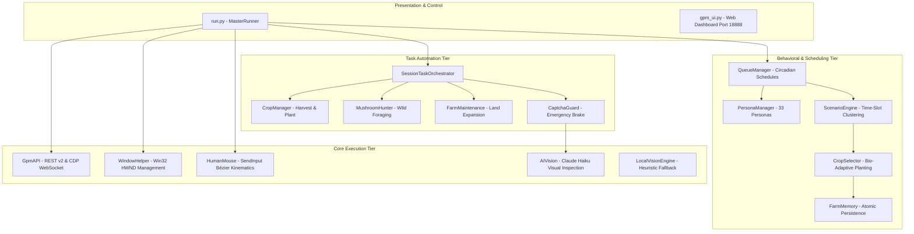
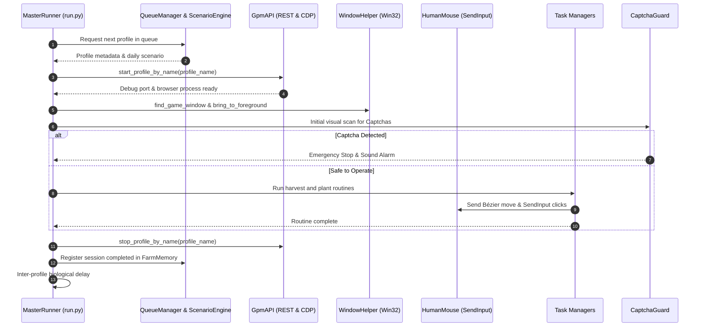

# System Architecture & Technical Specifications

## 1. Architectural Overview

The **SFL Autonomous Desktop RPA & Behavioral Simulation Prototype** is a multi-tier automation system designed for Windows x64. It operates entirely at the desktop and browser-core layers, avoiding vulnerable in-page script injections or predictable timing patterns.

---

## 2. Module Responsibilities

### Core Modules (`core/`)
* **`gpm_api.py` (`GpmAPI`)**:
  - Connects to GPM-Login Local REST API (`127.0.0.1:19995`).
  - Auto-detects port from Windows configuration (`api_port.dat`).
  - Resolves human-readable profile names to UUIDs (`find_profile_by_name()`, `start_profile_by_name()`, `stop_profile_by_name()`).
  - Communicates directly with the Chromium browser core via Chrome DevTools Protocol (CDP) WebSocket (`Runtime.evaluate`, `Page.navigate`, `Page.captureScreenshot`).
  - Identifies PIDs from listening debug ports (`find_pid_by_port`) and cleans up stuck instances via Windows `taskkill`.
* **`human_mouse.py` (`HumanMouse`)**:
  - Sends OS-level mouse events via Win32 API (`user32.dll -> SendInput`), generating native `isTrusted: true` DOM events.
  - Generates stochastic cubic Bézier trajectories with ease-in / ease-out velocity profiles, physiological tremor (micro-jitter 0.5–1.5px), hold duration variance (65–130ms), overshoot corrections, and deliberate fumble clicks.
  - Implements realistic human distraction pauses (AFK intervals) and idle cursor wandering.
* **`window_helper.py` (`WindowHelper`)**:
  - Enumerate visible windows, finds target game windows by title keyword (`preferred_title` or Sunflower Land).
  - Brings windows to foreground (`SetForegroundWindow`), restores minimized windows, and transforms coordinates between screen and client space.
* **`ai_vision.py` (`AIVision`)**:
  - Captures viewport via `PIL.ImageGrab` / `mss`.
  - Sends base64-encoded screenshots to OpenAI-compatible vision endpoints (Claude Haiku 5.5).
  - Enforces schema validation and bounding-box sanitation (`validate_and_sanitize`) to discard hallucinatory or out-of-bounds coordinates.
* **`local_vision_engine.py` (`LocalVisionEngine`)**:
  - Fast, offline template matching and heuristic pixel inspection when cloud AI vision is unavailable or rate-limited.
* **`evidence_engine.py` (`EvidenceFuser`, `TaskVerifier`) [Branch 1]**:
  - **POMDP Belief State (Kurniawati 2022)**: Models environmental state as a probability distribution over plot states (`GROWING`, `READY`, `EMPTY`, `UNKNOWN`, `BLOCKED`) with calibrated confidence scores.
  - **Bayesian Multi-Source Fusion**: Combines local heuristic computer vision (HSV/OpenCV) with VLM perception (Claude Haiku 5.5), applying conflict penalties when sources disagree.
  - **Explicit Abstention Policy**: Automatically halts automation (abstains from acting) when visual uncertainty exceeds 50%, or when CAPTCHA / game syncing indicators are detected.
  - **OSWorld Verifiable Predicates (Xie et al., NeurIPS 2024)**: Evaluates strict post-conditions for harvest (`ready_count` reduction) and planting (`empty_count == 0 and growing_count > 0`), classifying outcomes into `VERIFIED_SUCCESS`, `VERIFIED_PARTIAL`, `VERIFIED_FAILED`, or `ABSTAIN_UNCERTAIN`.

### Scheduler & Behavioral Engine (`scheduler/`)
* **`persona_manager.py` (`PersonaManager`)**:
  - Maintains persistent human identities (33 Vietnamese personas across diverse demographics, jobs, ages 19–45, and temperament profiles).
  - Persists attributes atomically to `personas.json`.
* **`goal_tracker.py` (`GoalTracker`, `TaskResumptionManager`) [Branch 2]**:
  - **ACT-R Cognitive Goal Hierarchy (Ritter et al., WIREs 2019)**: Establishes explicit goal decomposition (`MacroGoal` -> `SubGoalType` stack -> operators) cleanly decoupling perception, decision-making, and motor execution.
  - **Problem State Bottleneck & Task Interruption (Borst et al., CHI 2015)**: Serializes persistent `TaskCheckpoint` problem states before context switches, browser crashes, or timeouts.
  - **Discrepancy-Based Resumption (Trafton & Altmann 2003 Memory for Goals)**: Reconciles interrupted checkpoints with observed `EnvironmentBeliefState` upon session restart, resuming partial harvests or planting only empty plots without blind restarts.
* **`scenario_engine.py` (`ScenarioEngine`)**:
  - Generates daily narrative scenarios (Office Routine, WFH Marathon, Overtime Rush, Detox Day).
  - Implements time-slot clustering: sessions are grouped into realistic human windows (before work 06:45–08:15, lunch break 11:45–13:15, evening prime time 19:45–23:15) with hard lockout during work hours.
* **`crop_selector.py` (`SmartCropSelector`)**:
  - Dynamically calculates remaining free time until the next scheduled window.
  - Chooses crop maturity times matching the player's schedule (e.g., Sunflower for active play, Parsnip/Wheat for overnight sleep).
* **`farm_memory.py` (`FarmMemory`)**:
  - Tracks plot growth states, harvest cycles, human forgetfulness latency, and atomic persistence of task checkpoints (`save_checkpoint`, `get_checkpoint`, `clear_checkpoint`).
* **`queue_manager.py` (`QueueManager`)**:
  - Controls sequential profile execution, inter-profile relaxation delays, circadian nighttime sleep windows, and periodic coffee breaks.

### Task Automations (`tasks/`)
* **`crop_manager.py` (`CropManager`)**:
  - Orchestrates sequential plot interaction (harvesting and planting) with randomized visit orders (shuffling), breathing pauses, and miss-clicks.
* **`captcha_guard.py` (`CaptchaGuard`)**:
  - High-priority fail-safe: immediately halts mouse activity (0.01s reflex) upon detecting verification dialogs (Goblin Chest, Sunflower prompt).
  - Sounds acoustic alarm (`winsound`) and prompts for manual intervention.
* **`mushroom_hunter.py` (`MushroomHunter`)**:
  - Forages wild mushrooms from AI-identified coordinates.
* **`session_task_orchestrator.py` (`SessionTaskOrchestrator`)**:
  - Stochastically assigns task weights per persona and scenario.

---

## 3. Data Flow & Sequential Execution Pipeline

---

## 4. Key Architectural Decisions & Trade-Offs

1. **Sequential vs. Parallel Execution**:
   - *Decision*: Strictly execute one profile at a time.
   - *Rationale*: Reduces RAM and CPU consumption by over 90% compared to launching dozens of Chromium instances concurrently, while preventing cross-window focus contention in Win32 `SendInput`.
2. **Win32 `SendInput` vs. CDP Synthetic Mouse**:
   - *Decision*: Use Win32 OS-level hardware input as primary mouse mechanism.
   - *Rationale*: Win32 events trigger native OS input streams marked with `isTrusted: true`, preventing browser-level fingerprinting of synthetic CDP `Input.dispatchMouseEvent`.
3. **Atomic State Storage & PID-Aware Concurrency**:
   - *Decision*: Use atomic JSON file persistence (`write to .tmp -> os.replace` with backup `.bak`) coupled with PID-aware process locks (`.lock` storing owning process ID).
   - *Rationale*: Zero external database dependencies; dead process locks are automatically reclaimed by querying OS process tables (`_is_pid_alive`), while active process locks are strictly respected to prevent race conditions and lost updates across concurrent workers.
4. **Closed-Loop Verification & Decoupled Audit Logging**:
   - *Decision*: Decouple `execution_status` (e.g. `COMPLETED`, `COMPLETED_UNVERIFIED`, `ABORTED_PERCEPTION_FAILURE`) from `verification_status` (`VERIFIED_SUCCESS`, `VERIFIED_PARTIAL`, `VERIFIED_FAILED`, `UNVERIFIED`).
   - *Rationale*: Prevents false-positive success claims when post-condition visual evidence is missing or ambiguous. Success requires positive evidence of crop growth (`growing_count > 0 and empty_count == 0`).
5. **Perception Fail-Safe**:
   - *Decision*: Halt immediately if `capture_screenshot()` returns `None` or vision processing encounters an unrecoverable failure.
   - *Rationale*: Operating without current visual perception turns automation into blind clicking, leading to anti-detect detection and account suspension risks.
6. **Isolated Cleanup Handling**:
   - *Decision*: Wrap browser shutdown (`GpmAPI.stop_profile`) in dedicated try/except blocks inside `finally`.
   - *Rationale*: Preserves original exception traces and prevents cleanup failures from masking root operational crashes.
