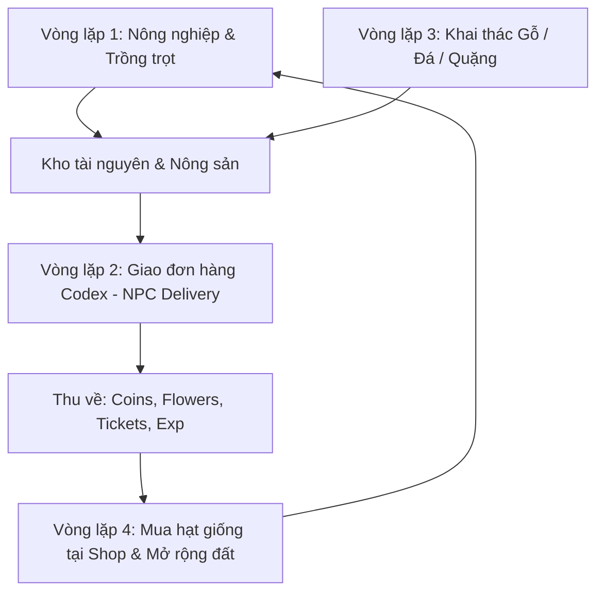

# PHÂN TÍCH TOÀN DIỆN GAMEPLAY SUNFLOWER LAND & CƠ CHẾ ANTI-BOT

> **Mục đích tài liệu:** Nắm vững 100% bản chất cơ chế trò chơi Sunflower Land, các luồng tương tác thực tế của người chơi, các rủi ro kích hoạt Captcha từ máy chủ, và quy tắc thiết kế Tool tự động hóa an toàn tuyệt đối.

---

## 1. TỔNG QUAN VỀ SUNFLOWER LAND (SFL)

Sunflower Land là tựa game nông trại, khai thác tài nguyên và kinh tế MMO chạy trên nền tảng Web3 (Polygon).
* **Môi trường hoạt động:** Chạy trên trình duyệt (Canvas HTML5 / Phaser Game Engine kết hợp giao diện React UI).
* **Cơ chế giao tiếp:** Mỗi hành động của người chơi đều kích hoạt một event gửi qua HTTP `POST` lên máy chủ `api.sunflower-land.com/actions` để cập nhật trạng thái nông trại (Farm State).

---

## 2. BỐN VÒNG LẶP HÀNH ĐỘNG CỦA NGƯỜI CHƠI (CORE GAME LOOPS)



---

### VÒNG LẶP 1: NÔNG NGHIỆP (FARMING & HARVESTING)

Đây là hoạt động căn bản và diễn ra với tần suất cao nhất trên hòn đảo chính (Home Farm).

1. **Các loại cây trồng (Crops):**
   * *Ngắn hạn:* Sunflower (1 phút), Potato (5 phút), Pumpkin (30 phút).
   * *Trung hạn:* Carrot (1 giờ), Cabbage (2 giờ), Beetroot (4 giờ), Cauliflower (8 giờ).
   * *Dài hạn:* Parsnip (12 giờ), Radish (24 giờ), Wheat (24 giờ), Kale (36 giờ), Corn...
2. **Chu kỳ chăm sóc từng ô đất (Plot Lifecycle):**
   * **Bước 1 (Đất trống):** Trạng thái đất màu nâu. Người chơi phải mở giỏ hạt (Seeds Inventory) $\rightarrow$ Chọn loại hạt muốn trồng $\rightarrow$ Click vào từng ô đất trống để gieo hạt.
   * **Bước 2 (Đang lớn - Growth):** Cây hiển thị mầm nhỏ và có đồng hồ đếm ngược. Lúc này **tuyệt đối không click vào ô đất** (click thừa thãi sẽ bị server ghi nhận là hành vi spam macro).
   * **Bước 3 (Chín - Ready to Harvest):** Cây nở hoa / củ to và có biểu tượng sẵn sàng. Người chơi click vào ô đất để thu hoạch nông sản vào giỏ.
   * **Hệ thống Nước (Water Well):** Giếng nước có giới hạn số lượng ô đất được cấp nước. Cần kích hoạt giếng để các ô đất được giảm thời gian sinh trưởng.
3. **Cân đối Nông sản & Mua Hạt giống (Seed Restock):**
   * Khi hết hạt giống, người chơi phải đến gặp NPC **Betty** (hoặc mở cửa hàng nông sản) để:
     - Bán bớt nông sản dư thừa lấy **Coins**.
     - Dùng Coins mua lại các gói hạt giống mới để tiếp tục canh tác.

---

### VÒNG LẶP 2: GIAO ĐƠN HÀNG CODEX (DELIVERIES & NPC ORDERS)
*(Đây là tính năng sinh lời cao nhất và là trọng tâm của hệ thống)*

1. **Giao diện Codex (Sách nhiệm vụ):**
   * Người chơi click vào biểu tượng quyển sách (Codex) ở thanh điều khiển.
   * Danh sách đơn hàng gồm nhiều ô hiển thị:
     - **Tên NPC nhận hàng** (Betty, Blacksmith, Tango, Corale, Tywin, Raven, Grimbly, Gordo...).
     - **Vật phẩm yêu cầu:** Số lượng nông sản, hoa, bánh, hoặc khoáng sản.
     - **Phần thưởng:** Coins, Seasonal Tickets, Flowers.
2. **Phân loại đơn hàng:**
   * 🟢 **Đơn có Tim đỏ (Ready):** Kho đồ đã đủ vật phẩm $\rightarrow$ Đủ điều kiện đi giao ngay.
   * 🟠 **Đơn màu cam (Chưa đủ / Không bõ công):** Nếu phần thưởng quá bèo bọt hoặc thiếu nguyên liệu khó kiếm $\rightarrow$ Cần bấm nút **Skip** để hệ thống tạo đơn mới sau một khoảng thời gian chờ (cooldown).
   * 🔒 **Đơn có ổ khóa (Locked):** Cần đạt cấp độ (Level) hoặc điều kiện nhất định mới mở.
3. **Di chuyển giữa các Đảo (World Travel):**
   * Người chơi không thể giao đơn tại chỗ mà phải điều khiển nhân vật di chuyển qua các bản đồ:
     - **Plaza (Quảng trường trung tâm):** Nơi tập trung Pete, Peggy, Bert, Cornwell, Raven, Tinker, Timmy, Betty, Blacksmith, Grimbly.
     - **Beach (Bờ biển):** Nơi ở của Corale, Tango, Old Salty, Miranda, Pharaoh, Finn, Finley.
     - **Kingdom (Vương quốc):** Nơi ở của Jester, Victoria, Tywin.
4. **Tương tác với NPC (NPC Interaction):**
   * Nhân vật di chuyển đến phạm vi gần NPC (tầm 30-50 pixel).
   * Click vào NPC để mở bảng đối thoại $\rightarrow$ Bấm nút **"Deliver"** để hoàn thành đơn và nhận thưởng.

---

### VÒNG LẶP 3: KHAI THÁC TÀI NGUYÊN (GATHERING)

1. **Chặt gỗ (Woodchopping):** Cây xanh trên đảo có thể bị chặt bằng Rìu (Axe). Cần vài nhát chặt để cây ngã, rơi ra gỗ (Wood). Sau đó cây cần thời gian hồi phục (2 giờ).
2. **Khai mỏ (Mining):** Các mỏ Đá (Stone), Sắt (Iron), Vàng (Gold) cần Cuốc (Pickaxe). Sau khi đập vỡ cần vài giờ để mỏ tái sinh.
3. **Năng lượng Bumpkin (Energy / Food):** Khai thác tài nguyên tiêu tốn thể lực. Khi hết năng lượng, cần ăn các món ăn chế biến từ bếp (Kitchen / Bakery).

---

## 3. CƠ CHẾ KÍCH HOẠT CAPTCHA VÀ BẪY PHÁT HIỆN BOT CỦA MÁY CHỦ SFL

Sunflower Land có một trong những hệ thống chống bot gắt gao nhất trong các web game:

```
[Hành động người chơi (Click)]
             │
             ▼
     POST /actions (API)
             │
             ├──► Máy chủ kiểm tra tần suất (Rate Limit)
             ├──► Máy chủ kiểm tra chu kỳ thời gian (Timing Patterns)
             └──► Máy chủ tích lũy điểm nghi vấn (Suspicion Score)
                         │
                         ▼
             Khi vượt ngưỡng nghi vấn:
                         │
        ┌────────────────┴────────────────┐
        ▼                                 ▼
[Modal Captcha Game]             [Cloudflare / Turnstile]
- Tìm rương kho báu Goblin        - Thử thách xác minh trình duyệt
- Chọn đúng hình nông sản         - Chặn đồng bộ State nếu thất bại
```

### 3.1. Các nguyên nhân kích hoạt Captcha:
1. **Click dồn dập khi game chưa kịp Sync (Rapid Unsynced Clicks):**
   - Khi bạn click thu hoạch 5 ô đất trong 0.2 giây, game gửi 5 request POST dồn dập. Máy chủ phát hiện tốc độ không tưởng của con người $\rightarrow$ Lập tức tung Captcha.
2. **Nhịp điệu đều chằn chặn (Metronome Timing):**
   - Click đúng 1000ms mỗi lần. Máy chủ chỉ cần thống kê độ lệch chuẩn $\sigma = 0$ là đánh dấu bot ngay.
3. **Tọa độ chết (Fixed Pixel Clicks):**
   - Bấm 10 lần vào ô đất đều trúng đúng pixel `(450, 320)` $\rightarrow$ 100% là phần mềm macro.
4. **Không chú ý đến phản hồi giao diện:**
   - Khi game đã hiện pop-up (ví dụ: "Rương đầy" hoặc bảng chúc mừng) mà chuột vẫn tiếp tục click vào các vị trí dưới nền đất.

### 3.2. Các dạng Captcha thường gặp trong SFL:
* **Goblin Chest / Puzzle:** Một bảng thông báo hiện lên với 3-5 chiếc rương hoặc hình ảnh khác nhau, yêu cầu người chơi chọn đúng chiếc rương có chìa khóa hoặc theo câu đố.
* **Sunflower Verification:** Chọn các hình ảnh chứa hoa hướng dương / nông sản theo yêu cầu.
* **Cloudflare Turnstile:** Bảng xác minh bảo mật khi đăng nhập hoặc chuyển đổi mạng.

---

## 4. BẢNG NGUYÊN TẮC VÀNG CHO THIẾT KẾ TOOL TỰ ĐỘNG HÓA

Để đảm bảo tài khoản chạy êm đẹp 100% không bao giờ dính cờ bot:

| Yếu tố | Hành vi của BOT DỎM (Dễ ăn ban) | Hành vi của TOOL CHUẨN NGƯỜI THẬT |
| :--- | :--- | :--- |
| **Bản chất click** | JS `element.click()` (`isTrusted: false`). | Win32 `SendInput` từ hệ điều hành (`isTrusted: true`). |
| **Quỹ đạo chuột** | Dịch chuyển tức thời (Teleport) hoặc đường thẳng. | Đường cong Bézier uốn lượn tự nhiên có gia tốc và rung tay. |
| **Tọa độ mục tiêu** | Cố định 1 điểm tâm `(X, Y)`. | Phân tán ngẫu nhiên $\pm 4$ đến $\pm 8$ pixel quanh mục tiêu. |
| **Nhịp độ thao tác** | Bấm liên tục không nghỉ, không chờ server. | Sau mỗi action, dừng nghỉ `400ms - 900ms` chờ game sync xong. |
| **Quan sát giao diện** | Mù quáng bấm theo kịch bản cố định. | **AI Vision (Claude Haiku)** quét màn hình theo từng chặng. |
| **Xử lý Captcha** | Không biết có Captcha, click bậy làm hỏng acc. | Phát hiện Captcha $\rightarrow$ **Đóng băng ngay**, phát cảnh báo. |
| **Thời gian vận hành** | Chạy 24/7 không ngừng nghỉ. | Có lịch trình ngủ đêm sinh học có Jitter, có nghỉ giải lao. |
| **Phân bổ phiên chơi** | Rải đều đặn mỗi 30-45p như máy (Uniform). | **Cụm giờ sinh hoạt (Time-Slots)**: Sáng trước đi làm, Trưa công sở, Tối Prime Time, Vùng cấm giờ làm việc. |
| **Độ trễ thu hoạch** | Hái đúng giây thứ 61 của cây 1 phút. | **Trễ quên tự nhiên**: Trễ 2 - 10 phút, đôi khi quên 1-2 tiếng do bận việc ngoài đời. |
| **Tính bất định thao tác**| Click chính xác 100% không bao giờ trượt. | Thỉnh thoảng **Click trượt (Fumble click)** ra mép cỏ rồi bấm lại, hoặc **Xao nhãng AFK 15-35s**. |
| **Đặc tính giữa các Acc** | Tất cả các acc dùng chung 1 logic thời gian. | **Mỗi Profile là 1 Bản thể sống động**: Có Tên, Tuổi, Nghề nghiệp, Tính khí, và Nhật ký đời sống riêng mỗi ngày! |

---

## 5. KẾT LUẬN & KIẾN TRÚC KỊCH BẢN CHUẨN

Một phiên làm việc chuẩn của Tool trên 1 profile GPM sẽ diễn ra theo đúng trình tự sinh học:
1. **Kiểm tra 3 Chốt chặn Sinh học:**
   - Đã chạm Session Cap hôm nay chưa?
   - Cây đã chín + Độ trễ quên tự nhiên chưa?
   - Hiện tại có đang nằm trong Khung giờ sinh hoạt hợp lệ (Active Time-Slot) của nhân vật hôm nay không?
2. **Khởi động:** Mở profile GPM $\rightarrow$ Chờ game load hoàn toàn $\rightarrow$ Dừng 3-5 giây ngắm nghía theo tốc độ chuột riêng.
3. **AI Quét tổng thể:** Claude Haiku chụp ảnh để kiểm tra Pop-up / Event / Captcha $\rightarrow$ Đóng pop-up nếu có.
4. **Thực thi nhiệm vụ:** 
   - Kiểm tra ruộng $\rightarrow$ Thu hoạch từng cây chín (có nhịp chờ 450-850ms giữa các cây).
   - Xác suất click trượt (Fumble click) 3-8% $\rightarrow$ nhấp lại vào tâm.
   - Xác suất xao nhãng AFK đời thực (shipper gọi, con khóc, nghe điện thoại) 10-35s.
   - Nhặt nấm hoang dã nếu AI phát hiện.
   - Gieo hạt mới $\rightarrow$ Hẹn giờ cho phiên kế tiếp theo công thức trễ quên sinh học.
5. **Kết thúc & Nghỉ ngơi:** Đóng profile an toàn qua GPM API $\rightarrow$ Nghỉ ngẫu nhiên 25s - 50s trước khi chuyển profile tiếp theo.
