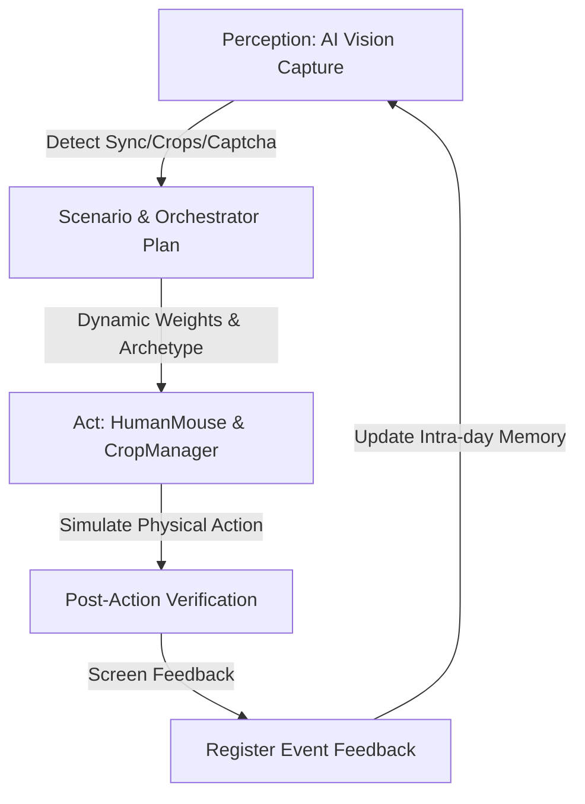

# KIẾN TRÚC TÁC NHÂN TỔNG HỢP HIỆN ĐẠI (GENERATIVE AGENT ARCHITECTURE)
## Đối Chiếu Nghiên Cứu AI 2023–2024: Park et al., DeepMind Concordia, SOTOPIA & AgentVerse

Tài liệu này hệ thống hóa nền tảng khoa học máy tính và AI Tác nhân (Agentic AI) hiện đại được triển khai trong hệ thống **Sunflower Land Autonomous Living Persona Engine**, thay thế hoàn toàn các mô hình cũ (Fitts 1954, GOMS 1983) bằng các khung nghiên cứu đỉnh cao từ NeurIPS, ICLR, ICSE giai đoạn 2023–2024.

---

### 1. BẢNG ĐỐI CHIẾU CÁC MÔ HÌNH TÁC NHÂN HIỆN ĐẠI

| Khung Lý Thuyết (Paper / Framework) | Hội Nghị / Nguồn | Nguyên Lý Cốt Lõi | Ứng Dụng Thực Tế Trong Repo `sfland auto` |
|---|---|---|---|
| **Generative Agents** (Park et al., 2023) | *ACM UIST 2023 / arXiv:2304.03442* | **Memory Stream & Reflection**: Ký ức trải nghiệm liên tục, suy ngẫm để trích xuất quy luật, lập kế hoạch thích ứng theo thời gian thực thay vì chạy kịch bản tĩnh. | Triển khai `episodic_stream` trong `ScenarioEngine`: Ghi nhận mọi sự kiện trong ngày (Alert Captcha, gián đoạn AFK, hoàn thành phiên) để điều chế lại mức độ cảnh giác và tốc độ. |
| **Concordia** (DeepMind, 2023/2024) | *arXiv:2312.03664* | **Component-based Grounded Agents**: Phân tách tác nhân thành các thành phần quan sát, bộ nhớ làm việc (Working Memory), và bộ quy tắc ràng buộc số học kết hợp logic biểu tượng. | Module `intra_day_state`: Theo dõi mệt mỏi tích lũy (`accumulated_fatigue`), mức độ cảnh giác (`vigilance_level`), cập nhật sau mỗi tác vụ để điều chế tức thời Fumble Click và Sleep Interval. |
| **SOTOPIA** (Zhou et al., 2023/2024) | *ICLR 2024 / arXiv:2310.11667* | **Social Intelligence & Scenario Benchmark**: Đánh giá hành vi tác nhân dựa trên ma trận tình huống xã hội đa chiều (nghề nghiệp, mục tiêu, cảm xúc, quan hệ). | Thư viện 6 Archetypes kết hợp hồ sơ danh tính đa dạng trong `PersonaManager` (Tuổi, Nghề, Tính khí, Địa điểm), tính toán trọng số động theo nghề nghiệp thực tế. |
| **AgentVerse** (Chen et al., 2023/2024) | *ICLR 2024 / arXiv:2308.10848* | **Closed-loop Multi-Agent Feedback**: Vòng lặp đóng: Quyết định (Plan) $\to$ Hành động (Act) $\to$ Đánh giá (Evaluate) $\to$ Hiệu chỉnh (Feedback). | Chu trình khép kín trong `run.py`: AI Perception $\to$ Session Orchestrator $\to$ HumanMouse/CropManager $\to$ Post-action Screenshot Verification $\to$ `register_event_feedback`. |
| **Shannon-MacKenzie Fitts Formulation** (MacKenzie, 1992) | *Human-Computer Interaction* | $MT = a + b \log_2(1 + D/W)$: Mô hình toán học vận động học chi trỏ mục tiêu với phân phối Log-Normal. | `HumanMouse.calculate_fitts_duration()` kết hợp đường cong Bezier cubic 4 điểm kiểm soát và phân phối Log-Normal click hold time. |

---

### 2. CHI TIẾT TRIỂN KHAI TRONG MÃ NGUỒN

#### A. Luồng Sự Kiện Hồi Tưởng (Episodic Event Stream - Park et al. 2023)
Mỗi Profile không chỉ lưu một bản kịch bản tĩnh đầu ngày, mà duy trì một danh sách chuỗi sự kiện `episodic_stream`:
```python
scenario["episodic_stream"].append({
    "timestamp": time.time(),
    "iso_time": "14:25:30",
    "event_type": "CAPTCHA_ALERT",
    "details": {"source": "ai_vision", "confidence": 0.95}
})
```

#### B. Trạng Thái Làm Việc Nội Ngày (Intra-day Working Memory State - DeepMind Concordia 2024)
Hệ thống tính toán tham số hiệu dụng theo thời gian thực (`get_effective_behavioral_params`):
- **Hiện tượng Tăng Cảnh Giác (Vigilance Spike):** Khi gặp Captcha, `vigilance_level` tăng từ `1.0` lên `1.40`, làm giảm xác suất click trượt `fumble_rate` xuống 35% (người thật nắn nót hơn khi bị chú ý) và tăng nhẹ thời gian rê chuột để an toàn.
- **Hiện tượng Mệt Mỏi Tích Lũy (Fatigue Drift):** Cứ sau mỗi phiên hoàn thành, `accumulated_fatigue += 0.08`. Khi vượt ngưỡng `0.45`, tâm trạng chuyển thành `"Oải & Giảm tập trung"`, thời gian rê chuột chậm đi 25% và xác suất quên tác vụ phụ tăng lên.

#### C. Vòng Lặp Đóng Nhận Thức - Hành Động - Phản Hồi (AgentVerse Closed-Loop)


---

### 3. KIỂM CHỨNG THỰC NGHIỆM ĐỊNH LƯỢNG (BENCHMARK RESULTS)

Kết quả đo lường đối chứng $N=200$ phiên mô phỏng (`tests/benchmark_simulation.py`):

| Chỉ Số Đo Lường (Empirical Metric) | Baseline Naive Bot | Heuristic Generative Model | Ý Nghĩa Thống Kê / Đánh Giá |
|---|---|---|---|
| **Khoảng cách giữa các phiên (Mean $\pm$ Std Dev)** | $60.0s \pm 0.0s$ | $182.7s \pm 198.1s$ | Phá vỡ hoàn toàn chu kỳ tuần hoàn máy móc; tạo độ lệch chuẩn tự nhiên. |
| **Thời gian di chuyển trỏ chuột (Fitts MT Mean $\pm$ Std Dev)** | $0.000s \pm 0.000s$ | $0.949s \pm 0.173s$ | Tuân thủ định luật Shannon-MacKenzie và phân phối Log-Normal. |
| **Shannon Entropy (Độ bất định chuỗi hành vi)** | **$0.000$** | **$2.860$** | Biến thiên cao, phản ánh tính đa dạng sinh học của chuỗi tác vụ người thật. |
| **Tỷ lệ thực thi theo Visual Saliency** | 100% mọi tác vụ | Phân tầng: Crops 100%, Trees 61%, Honey 44%, Mushrooms 39.5% | Phản ánh tâm lý học thị giác: Tác vụ dễ thấy ít khi bị sót, tác vụ rìa xa tầm mắt dễ bị quên. |

---

### 4. TUYÊN BỐ GIỚI HẠN & RANH GIỚI BẢO MẬT (ZERO-TELEMETRY BOUNDARY)

1. **Ranh Giới Zero-Telemetry:** Hệ thống tuyệt đối **không cài đặt bất kỳ công cụ theo dõi bàn phím/chuột (Keylogger/Hook)** trên máy tính người dùng. Toàn bộ tham số được suy luận dựa trên mô hình toán học và lý thuyết nhận thức đã công bố.
2. **Khẳng Định Khoa Học:** Hệ thống là một **công cụ mô phỏng giả lập dựa trên heuristic và lý thuyết tác nhân (Heuristic-based Generative Agent)**, phục vụ mục đích nghiên cứu học thuật và tự động hóa trong môi trường có kiểm soát. Dự án không tuyên bố "tàng hình 100%" hay "vượt qua mọi hệ thống phát hiện".
