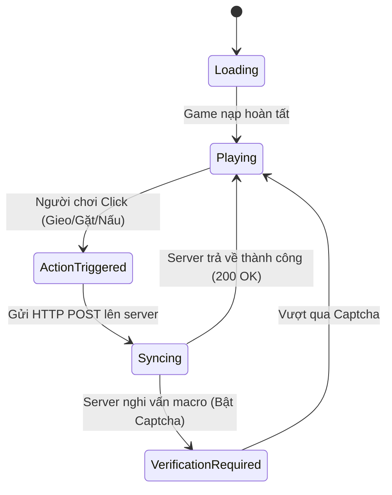

# ĐẠI ĐIỂN TRI THỨC TOÀN DIỆN SUNFLOWER LAND (SFL MASTER ENCYCLOPEDIA)
> **Tài liệu tham chiếu chuẩn cho AI Agent & Hệ thống Tự động hóa**  
> **Phiên bản:** SFL Complete Knowledge 2026 | **Dự án:** GPM Desktop RPA Bot

---

## MỤC LỤC
1. [Kiến trúc Kỹ thuật & Engine của Game](#1-kiến-trúc-kỹ-thuật--engine-của-game)
2. [Hệ thống Nông nghiệp & Cây trồng (Crops & Growth Matrix)](#2-hệ-thống-nông-nghiệp--cây-trồng-crops--growth-matrix)
3. [Hệ thống Nấm hoang dã (Wild & Magic Mushrooms)](#3-hệ-thống-nấm-hoang-dã-wild--magic-mushrooms)
4. [Hệ thống Ủ phân & Bón đất (Composters & Bins)](#4-hệ-thống-ủ-phân--bón-đất-composters--bins)
5. [Hệ thống Bếp nấu & Nâng cấp Bumpkin (Cooking & Food Recipes)](#5-hệ-thống-bếp-nấu--nâng-cấp-bumpkin-cooking--food-recipes)
6. [Hệ thống Khai thác Tài nguyên (Woodchopping & Mining)](#6-hệ-thống-khai-thác-tài-nguyên-woodchopping--mining)
7. [Hệ thống Thực khách NPC tại Farm (Visiting Diners)](#7-hệ-thống-thực-khách-npc-tại-farm-visiting-diners)
8. [Mô hình Trạng thái (XState Machine) & Nhịp Sync mạng](#8-mô-hình-trạng-thái-xstate-machine--nhịp-sync-mạng)
9. [Cơ chế Chống Bot & Bẫy Captcha (Anti-Cheat & Verification)](#9-cơ-chế-chống-bot--bẫy-captcha-anti-cheat--verification)
10. [Ma trận Ra quyết định cho Tool (Decision Matrix for Automation)](#10-ma-trận-ra-quyết-định-cho-tool-decision-matrix-for-automation)

---

## 1. KIẾN TRÚC KỸ THUẬT & ENGINE CỦA GAME

* **Frontend:** React 18 + HTML5 Canvas chạy trên **Phaser Game Engine**.
* **Quản lý Trạng thái:** **XState** (`gameMachine`). Mọi hành động của người chơi đều chuyển đổi trạng thái cục bộ trước, sau đó gửi sự kiện (Event) lên máy chủ.
* **Backend API:** `https://api.sunflower-land.com/actions` (nhận gói tin HTTP POST ký tên từ phiên làm việc của người dùng).
* **Chu kỳ Đồng bộ (Autosave Loop):** Game tự động gửi gói đồng bộ trạng thái sau mỗi chuỗi hành động hoặc sau mỗi 30–60 giây. Khi đồng bộ, biểu tượng vòng xoay ("Syncing...") sẽ xuất hiện trên màn hình.

---

## 2. HỆ THỐNG NÔNG NGHIỆP & CÂY TRỒNG (CROPS & GROWTH MATRIX)

### 2.1. Bảng Thông số Cây trồng Căn bản

| Tên Cây | Cấp mở khóa | Thời gian lớn chuẩn | Giá mua hạt (SFL/Coin) | Giá bán nông sản | Vai trò chính |
| :--- | :---: | :---: | :---: | :---: | :--- |
| **Sunflower** | 0 | **1 phút** | Rất rẻ | Lãi nhỏ | Cày exp đầu, ủ Sprout Mix, quay vòng nhanh |
| **Potato** | 0 | **5 phút** | Rẻ | Thấp | Nấu Mashed Potato, đơn hàng NPC |
| **Pumpkin** | 2 | **30 phút** | Trung bình | Trung bình | Nấu Pumpkin Soup, ủ phân, giao đơn |
| **Carrot** | 2 | **1 giờ** | Trung bình | Khá | Nuôi thú, ép nước Carrot Juice, giao đơn |
| **Cabbage** | 3 | **2 giờ** | Khá | Khá | Nấu Cabbers n Mash, làm bánh Cabbage Cake |
| **Beetroot** | 3 | **3h 36m** | Khá | Cao | Nấu ăn cao cấp, giao đơn Codex |
| **Cauliflower** | 4 | **7h 12m** | Cao | Cao | Bán lấy coin lớn, giao đơn giá trị |
| **Parsnip** | 4 | **10h 48m** | Cao | Rất cao | Trồng qua đêm / treo máy dài hạn |
| **Radish** | 5 | **21h 36m** | Rất cao | Rất cao | Nhiệm vụ nâng cấp đất, đơn thưởng lớn |
| **Wheat** | 5 | **21h 36m** | Rất cao | Rất cao | Làm bột mì, thức ăn gia súc (gà, bò), nướng bánh |
| **Kale** | 7 | **32h 24m** | Đắt đỏ | Cực cao | Nấu bánh Kale & Mushroom Pie, đơn cao cấp |

*(Lưu ý: Thời gian thực tế sẽ giảm mạnh nếu có Bù nhìn rơm Scarecrow, kỹ năng Green Thumb, hoặc bón phân Rapid Root -50%).*

### 2.2. Vòng đời 1 Ô đất (Soil Plot Lifecycle)
```
[Đất Trống (Màu Nâu)] 
       │ ──► Mở Giỏ Hạt -> Chọn Hạt -> Gieo hạt (Action: plant)
       ▼
[Đang Lớn (Mầm xanh + Đếm ngược)] 
       │ ──► TUYỆT ĐỐI KHÔNG CLICK (Tránh spam vô ích gây nghi vấn bot)
       ▼
[Chín (Cây nở to + Biểu tượng thu hoạch)] 
       │ ──► Click thu hoạch (Action: harvestCrop) -> Trở về Đất Trống
```

---

## 3. HỆ THỐNG NẤM HOANG DÃ (WILD & MAGIC MUSHROOMS)

* **Cơ chế Sinh trưởng (Spawn Logic):**
  - Không cần trồng! Game tự động thả nấm ngẫu nhiên trên các mảng cỏ trống (Wilderness Grass) sau mỗi **4 đến 16 giờ**.
  - Hiệu ứng thời tiết mưa (Rainy weather) làm tăng tỉ lệ mọc nấm.
* **Phân loại:**
  1. **Wild Mushroom (Nấm thường - Nâu/Đỏ):** Dùng để nấu món *Shroom Syrup* (mất 10 giây tại Deli), làm bánh *Kale & Mushroom Pie* tại Bakery, và ủ phân.
  2. **Magic Mushroom (Nấm ma thuật - Tím):** Cực kỳ quý hiếm, dùng cho các công thức phù thủy và giao dịch giá trị cao.
* **Quy tắc cho Tool:** Mỗi khi mở game, quét toàn bộ dải cỏ xung quanh ruộng. Nếu phát hiện icon cây nấm, **ưu tiên di chuột đến nhặt ngay lập tức** trước khi làm các việc khác.

---

## 4. HỆ THỐNG Ủ PHÂN & BÓN ĐẤT (COMPOSTERS & BINS)

Khu vực 3 thùng vàng cạnh nhà chính:

| Tên Thùng Ủ | Thời gian ủ | Nguyên liệu đầu vào | Sản phẩm đầu ra | Công dụng đặc biệt |
| :--- | :---: | :--- | :--- | :--- |
| **1. Compost Bin** (Thùng cơ bản) | **6 giờ** | Nông sản cơ bản (Sunflower, Carrot, Pumpkin) | **Sprout Mix** + Giun đất (Earthworm) | Bón vào đất: Tăng thêm sản lượng nông sản khi thu hoạch (+0.2 yield). |
| **2. Turbo Composter** (Thùng tăng tốc) | **8 giờ** | Nông sản trung hạn + Trứng gà (Eggs) | **Fruitful Blend** + Sâu (Grub) | Tăng sản lượng cây ăn quả (Apple, Orange, Blueberry). |
| **3. Premium Composter** (Thùng cao cấp) | **12 giờ** | Cây ăn quả cao cấp + Nấm + Trứng | **Rapid Root** + Giun đỏ (Red Wiggler) | **SIÊU PHẨM:** Giảm **50% thời gian lớn** của mọi loại cây trồng! |

* **Quy tắc cho Tool:**
  - Nếu thùng có dấu tích xanh (Ready) $\rightarrow$ Click thu hoạch phân bón.
  - Nếu thùng đang rảnh $\rightarrow$ Click nạp nguyên liệu thừa để bấm ủ đợt mới.

---

## 5. HỆ THỐNG BẾP NẤU & NÂNG CẤP BUMPKIN (COOKING & FOOD RECIPES)

Nhân vật Bumpkin cần ăn đồ nấu chín để tích lũy **EXP** tăng cấp (Level). Cấp càng cao càng mở khóa đất mới và mở rộng tính năng.

### Các công trình nấu ăn:
1. **Fire Pit (Bếp Lửa Trại - Mặc định Level 0):**
   - *Mashed Potato:* 30 giây (Nguyên liệu: 8 Potato).
   - *Pumpkin Soup:* 3 phút (Nguyên liệu: 10 Pumpkin).
   - *Reindeer Carrot:* 5 phút (Nguyên liệu: 5 Carrot).
   - *Popcorn:* 12 phút (Nguyên liệu: Bắp ngô).
   - *Pizza Margherita:* 20 giờ (Món cao cấp nhiều EXP nhất bếp lửa).
2. **Bakery (Tiệm Bánh Mì - Mở ở Level 11):**
   - *Apple Pie / Orange Cake:* 4 giờ.
   - *Kale & Mushroom Pie:* 4 giờ (Cần Nấm + Cải Kale).
   - *Sunflower Cake:* 6 giờ 30 phút.
   - *Wheat Cake:* 24 giờ.
3. **Deli (Tiệm Đồ Nguội & Lên Men - Mở ở Level 16):**
   - *Shroom Syrup:* **10 giây** (Chế biến siêu tốc từ Nấm hoang dã).
   - *Cheese:* 20 phút.
   - *Blueberry Jam / Sauerkraut:* 12h - 24h.

---

## 6. HỆ THỐNG KHAI THÁC TÀI NGUYÊN (WOODCHOPPING & MINING)

### 6.1. Rừng cây lấy Gỗ (9 cây xanh trên cùng đảo):
* **Công cụ yêu cầu:** Rìu gỗ (Axe) chế tạo tại Workbench.
* **Thời gian cây hồi sinh:** **2 giờ** sau khi bị đốn ngã.
* **Sản lượng:** 3 - 5 Gỗ (Wood) mỗi cây.

### 6.2. Mỏ đá & Quặng (Khu vực đá tròn dưới ruộng):
* **Công cụ yêu cầu:** Cuốc (Pickaxe).
* **Thời gian tái sinh từng mỏ:**
  - *Mỏ Đá (Stone Rock):* **4 giờ** $\rightarrow$ Rơi ra Đá.
  - *Mỏ Sắt (Iron Rock):* **12 giờ** $\rightarrow$ Rơi ra Quặng Sắt.
  - *Mỏ Vàng (Gold Rock):* **24 giờ** $\rightarrow$ Rơi ra Quặng Vàng.

---

## 7. HỆ THỐNG THỰC KHÁCH NPC TẠI FARM (VISITING DINERS)

* **Hiện tượng:** Các NPC (như anh chàng ăn pizza, cô bé ăn bánh trong ảnh chụp của bạn) sẽ ghé thăm hòn đảo chính và ngồi đợi quanh các bàn ăn/bếp lửa.
* **Hành động của người chơi:**
  - Khi bạn nấu xong đúng món NPC đang thèm $\rightarrow$ Trên đầu NPC sẽ hiện biểu tượng món ăn kèm dấu chấm than.
  - Click vào NPC $\rightarrow$ Bấm nút trao món ăn $\rightarrow$ **Nhận ngay một lượng lớn Coins và EXP Bumpkin**.
* **Lợi ích:** Tiện lợi hơn nhiều so với việc đi sang các đảo khác giao hàng vì NPC ở ngay tại sân nhà!

---

## 8. MÔ HÌNH TRẠNG THÁI (XSTATE MACHINE) & NHỊP SYNC MẠNG

Sunflower Land vận hành theo các trạng thái hữu hạn (State Transitions):



### Quy tắc sống còn khi đồng bộ (Network Sync):
* Khi ở trạng thái `Syncing`, trên màn hình sẽ có icon bánh răng/vòng tròn xoay.
* **LỆNH CẤM CHO TOOL:** Tuyệt đối không click chuột trong khi vòng xoay đang quay. Phải đợi game quay về trạng thái `Playing` ổn định rồi mới tiếp tục hành động tiếp theo.

---

## 9. CƠ CHẾ CHỐNG BOT & BẪY CAPTCHA (ANTI-CHEAT & VERIFICATION)

### 9.1. Ba Bẫy phát hiện Bot:
1. **Bẫy Tần số (Frequency Flood):** Thực hiện quá nhiều action trong 1 giây mà không có độ trễ nghỉ (Delay). Người thật cần từ 400ms – 900ms giữa mỗi lần click.
2. **Bẫy Tọa độ chết (Pixel Lock):** Bấm trúng cùng 1 pixel chính xác $100\%$ qua nhiều chu kỳ. Cần phải có độ lệch ngẫu nhiên (Jitter) $\pm 4$ đến $\pm 8$ px.
3. **Bẫy Cờ trình duyệt (`isTrusted: false`):** Bắn sự kiện từ code Javascript/DOM bên trong tab. Server và trình duyệt dễ dàng phát hiện. Bắt buộc phải dùng **Win32 `SendInput` từ hệ điều hành**.

### 9.2. Các Dạng Thử thách Xác minh (Proof of Humanity Modals):
* **Goblin Chest Puzzle:** Một modal bung ra giữa màn hình hiển thị 3 - 5 chiếc rương có hình thù khác nhau, yêu cầu bấm đúng rương mở khóa.
* **Sunflower Count / Item Match:** Yêu cầu chọn đúng biểu tượng hoa hướng dương hoặc nông sản theo câu hỏi.
* **Turnstile Cloudflare:** Xuất hiện khi đăng nhập hoặc chuyển đổi phiên lớn.

### 9.3. Phản ứng Chuẩn của Tool khi gặp Captcha:
1. **Lập tức đóng băng chuột (Mouse Freeze):** Dừng mọi thao tác di chuyển/click chuột ngay tức khắc để không click sai đề bài.
2. **Kích hoạt Báo động (Alert Trigger):** Phát âm thanh cảnh báo trên loa máy tính và tạm dừng phiên của profile đó.

---

## 10. MA TRẬN RA QUYẾT ĐỊNH CHO TOOL (DECISION MATRIX FOR AUTOMATION)

Khi Tool điều phối một Profile GPM, trình tự tư duy và ra lệnh sẽ tuân theo Ma trận 6 bước sinh học:

```
[BƯỚC 0: KIỂM SOÁT NHỊP SINH HỌC & CỤM GIỜ SỐNG ĐỘNG]
- Kiểm tra 3 Chốt chặn Sinh học:
  1. Profile đã chạm Session Cap theo kịch bản hôm nay chưa? (0 - 22 phiên).
  2. Cây đã chín + Độ trễ quên tự nhiên chưa? (Đã tính xác suất quên 1-2h).
  3. BÂY GIỜ CÓ ĐANG TRONG KHUNG GIỜ SINH HOẠT HỢP LỆ (Time-Slot Clustering)?
     -> Nếu ngoài khung giờ: Tạm nghỉ, chờ đến khung giờ tiếp theo (sáng, trưa, tối).

[BƯỚC 1: KHỞI TẠO & NHẬN DIỆN BẢN THỂ]
- Đọc ADN & Danh tính người thật: Tên, Tuổi, Nghề nghiệp, Tính khí.
- Áp dụng Hệ số mệt mỏi theo giờ (Fatigue Multiplier) & Tốc độ chuột riêng.
- Mở Profile GPM -> Chờ màn hình nạp 100% -> Chờ ngắm cảnh tự nhiên 3-5s.

[BƯỚC 2: AI VISION SCAN - CLAUDE HAIKU 5.5]
- Chụp ảnh màn hình:
  + Có Pop-up che (Daily Reward, Welcome)? -> Bấm nút 'X' tắt.
  + Có vòng xoay 'Syncing'? -> Dừng chờ 1-2s.
  + Có Captcha? -> ĐÓNG BĂNG NGAY LẬP TỨC (0.01s) & Hú còi báo động.

[BƯỚC 3: ƯU TIÊN THAO TÁC FARM & TÍNH BẤT ĐỊNH CON NGƯỜI]
1. NHẶT NẤM: Quét bãi cỏ rìa ngoài -> Có nấm thì di chuột nhặt ngay.
2. RUỘNG CHÍN: Xáo trộn ngẫu nhiên thứ tự ô đất (Shuffle) -> Thu hoạch.
   - Xác suất click trượt (Fumble click: 3-8%) ra mép cỏ rồi bấm lại.
   - Xác suất xao nhãng AFK đời thực (10-35s): shipper gọi, con khóc, nghe máy.
   - Nhịp thở 450ms - 850ms sau mỗi ô để game gửi POST đồng bộ.
3. GIEO HẠT: Mở giỏ hạt -> Chọn hạt -> Gieo hạt kèm tính bất định.
4. HẸN GIỜ PHIÊN TIẾP THEO: Ghi nhớ vào FarmMemory (Thời điểm chín + Trễ quên sinh học).

[BƯỚC 4: HẬU KIỂM AN TOÀN]
- Chụp ảnh lần cuối xác nhận ruộng sạch, không có cảnh báo lỗi.

[BƯỚC 5: ĐÓNG & NGHỈ NGƠI SINH HỌC]
- Đóng Profile qua GPM API.
- Nghỉ giải lao ngẫu nhiên 25s - 50s giữa 2 profile.
- Cứ sau mỗi 5 profile: Kích hoạt Coffee Break dài 3 - 7 phút.
```
